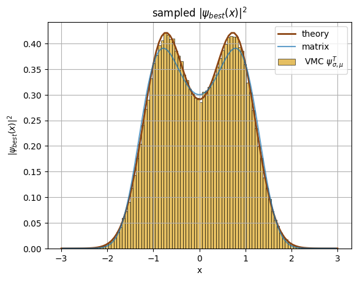
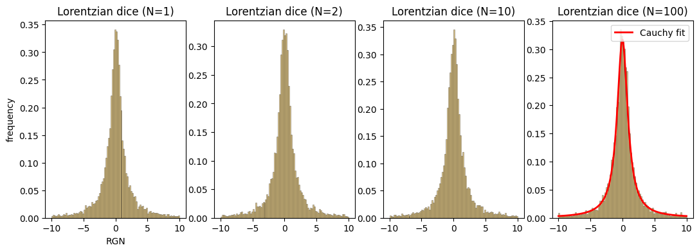
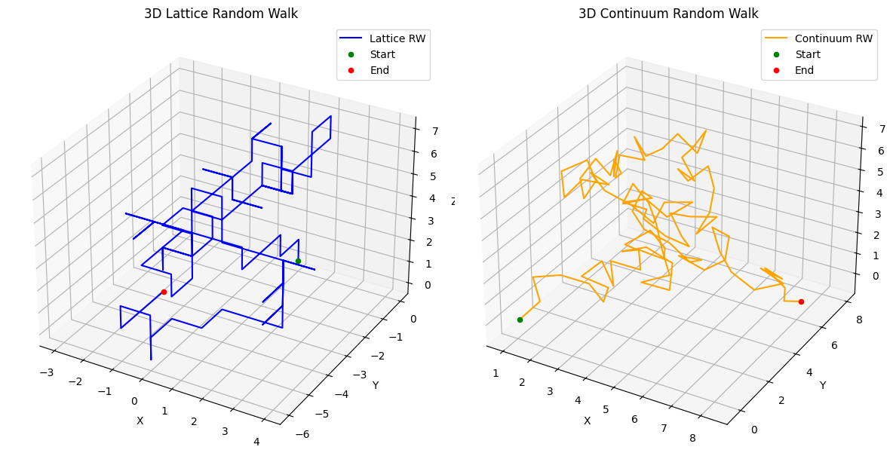
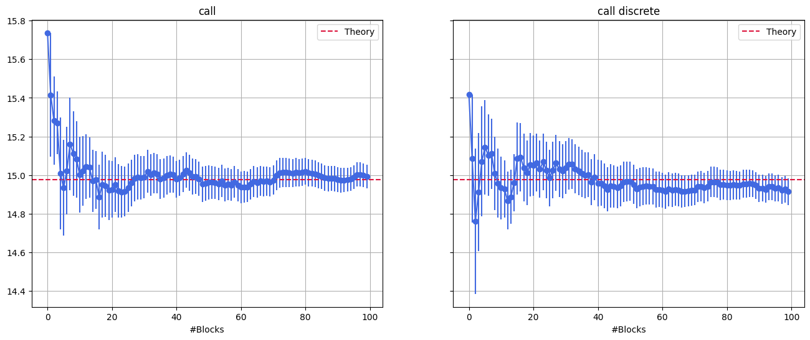

# Monte Carlo methods

A collection of Monte Carlo simulations, mostly written in C++, from testing a random number generator to variational Monte Carlo for a quantum particle. Every folder contains the code and a notebook with the theory, the results and the plots.

The simulations were developed starting from the framework of the Numerical Simulation Laboratory course (prof. D.E. Galli, University of Milan): the parallel random number generator (`random.cpp`, `random.h`) and the input files were provided by the course. The random walks notebook (`05_random_walks_and_saw`, in Python) comes from the Statistical Physics course (prof. S. Zapperi, University of Milan), and the theory parts are taken from the course material.



## Contents

**01_random_numbers** - test of the random number generator (mean, variance and Pearson χ² test) using the data blocking method to estimate the errors. Then a check of the central limit theorem with uniform, exponential and Lorentzian "dice": the first two converge to a gaussian, while the Lorentzian stays a Lorentzian since its variance is not finite. Finally π is computed with the Buffon's needle experiment.



**02_mc_integration_and_random_walks** - Monte Carlo integration with uniform sampling and with importance sampling, and 3D random walks on a lattice and in the continuum, checking that the mean square displacement grows as √N (diffusive behaviour).



**03_black_scholes_option_pricing** - price of European call and put options computed by sampling the geometric Brownian motion of the asset, both directly at the expiry time and with a discretized path, and compared with the analytic Black-Scholes solution.



**04_variational_monte_carlo** - ground state of a 1D particle in the double well V(x) = x⁴ - 5/2 x². The trial wavefunction (sum of two gaussians) is sampled with Metropolis and its parameters are optimized with simulated annealing, using the energy as loss. The result is compared with the exact solution obtained by diagonalizing the discretized Hamiltonian (plot at the top).

**05_random_walks_and_saw** - numerical check of how the expected number of returns to the origin of a random walk scales with its length (√n in 1D, log n in 2D, constant for d ≥ 3), and generation of 2D self-avoiding walks with the pivot algorithm, a Markov chain Monte Carlo on the set of self-avoiding paths.

## Usage

Each program is in a `SOURCE` folder with its Makefile, reads the inputs from `../INPUT` and writes the results in `../OUTPUT`:

```
cd 01_random_numbers/1.1/SOURCE
make
./main.exe
```

The variational Monte Carlo takes an argument: `./vmc 0` optimizes the parameters and then runs, `./vmc 1` only runs with the best parameters of the last optimization. The notebooks read the data from the `OUTPUT` folders.

The random walks notebook only needs numpy and matplotlib.
